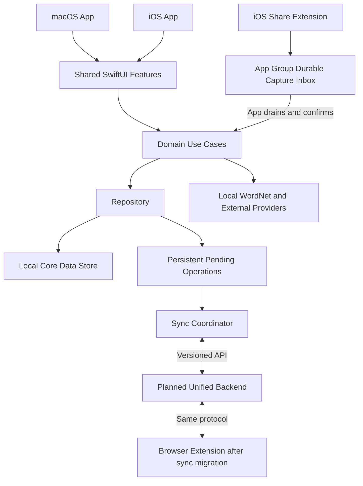

# Remember Me macOS 和 iOS 前端实施计划

日期：2026-10-08，更新：2026-10-09。状态：实施中。双端本地词库、查词、备份恢复、复习与分享草稿已落地；导入中断恢复和分批复制已通过验证；真机、分享签名、通知投递与后端同步尚未验收。

目标是在现有浏览器扩展之外增加 macOS 和 iOS 原生客户端，让词库整理、查词和复习可以在电脑与手机上独立完成。建议采用 SwiftUI 共享业务与展示组件，保留两端各自的交互和系统集成；先交付本地可用的客户端，再接入统一后端同步。

当前扩展继续独立运行；`frontend/apple/` 已有两端 App、iOS Share Extension、本地 Swift packages 和共享词库/编辑/备份/复习界面。后端已有本地 API 与原生登录兑换；原生凭证、登录设置、同步核心、账号归属和基础同步界面已实现；在线账号备份合并恢复、epoch 恢复预览/原子发布和本地 Swift/HTTP/Worker/D1 联调已通过隔离验证；来源选项/补充、线上/签名设备联调与完整验收尚未完成。本文补充[项目架构](architecture.md)和[Cloudflare 实施计划](cloudflare-implementation-plan.md)，当前扩展的数据格式保持不变。实际结果见[基础验证记录](../frontend/apple/docs/verification/2026-10-08-foundations.md)和[本地功能验证记录](../frontend/apple/docs/verification/2026-10-08-local-features.md)。

## 首版范围与待确认选择

以下作为实施默认值，可以据此启动阶段零和最小工程；设备、签名和性能预算由阶段零记录实际结果。后续范围调整须同步修改契约、阶段交付与验收，不把未回答的产品选择留给各端自行解释。

| 项目 | 首版默认范围 |
| --- | --- |
| 客户端 | 原生 macOS App 与 iPhone App；iPad 先保证自适应布局 |
| 使用方式 | 先个人自用，保留公开发布能力 |
| 最低系统 | macOS 14、iOS 17；首版验收使用 Apple Silicon Mac 与 iPhone，iPad 验证基础布局，Intel Mac 暂不承诺正式支持 |
| 词库 | 搜索、按计数或更新时间排序、详情、历史、手工添加编辑、删除确认、重置计数；类型与后端共用 word / phrase / abbreviation / proper_noun |
| 数据迁入 | 导入现有扩展 JSON；本地备份和新版恢复 |
| 查词 | 已保存释义和打包 WordNet 优先；英文回退使用 Free Dictionary API，中文使用 MyMemory；首版自动请求限于扩展接受的单个英文词，其他类型可手工填写释义 |
| 采集 | 用户主动粘贴；iOS Share Extension 接收宿主实际提供的文本或 URL |
| 复习 | 今日复习、忘记／模糊／记得、本文定义的 review-v1 和可选本地提醒；默认每天最多引入 20 个新词 |
| 同步 | 后端就绪后启用；支持离线修改、重启续传和显式冲突处理 |
| 后续功能 | Safari 划词采集、macOS 菜单栏快捷入口、Widgets、App Intents、OCR、高级记忆算法 |

复制或分享仅创建待确认草稿，查看词条不增加遗忘次数。明确点击“记录一次遗忘”才增加计数并产生 encounter；手工新建词条不伪造浏览历史。首次启动无需登录即可使用本地词库，云同步单独开启。

第一交付里程碑是两端本地词库、查词与备份，第二里程碑增加本地复习与提醒，第三里程碑接入统一后端同步。Safari、菜单栏与公开商店发布留在后续范围。签名不足时可先完成模拟器与本地 Mac 开发，但分享和 iPhone 真机验收仍标为未完成；不以模拟器结果替代。

原生 App 不直接读取 Chrome 的扩展存储或浏览器配置目录。后端尚未就绪时，通过用户导出的 JSON 转移词库；以后由扩展、网站和 Apple 客户端共同接入同一同步协议。原生客户端上线不依赖先完成整套网站 UI。

## 技术方案

| 层次 | 建议实现 | 选择依据 |
| --- | --- | --- |
| 界面 | SwiftUI，必要时薄层适配 AppKit / UIKit | Apple 两端共享组件，同时保留窗口、键盘、导航与分享差异 |
| 业务 | 本地 Swift Package，纯 Swift 数据模型与 use case | 避免业务依赖某个平台视图或 Xcode target |
| 持久化 | Core Data，使用本地 SQLite store，不启用 CloudKit 镜像 | 支持离线实体、模型迁移和待同步操作的持久化；云同步统一走项目后端 |
| 网络 | URLSession、async/await、Codable DTO | 连接统一 API，明确超时、取消、错误和会话刷新 |
| 凭证 | Keychain | 登录令牌不进入词库、UserDefaults、导出文件或日志 |
| 提醒 | UserNotifications | 按用户选择的时间安排本地提醒 |
| 工程 | 一个 Xcode project，macOS 与 iOS 两个 App target，共享本地 Swift Package | 两端独立签名和发布，减少重复业务代码 |
| 验证 | Swift Testing / XCTest、临时磁盘 store、XCUITest、实际设备 | 区分业务测试、持久化恢复与平台行为 |

[SwiftUI](https://developer.apple.com/documentation/swiftui/app-organization)支持跨 Apple 平台共享代码和平台适配；[Core Data](https://developer.apple.com/documentation/coredata/)提供本地持久化与迁移。这里选择 Core Data 是为了优先落实持久化操作队列；不同时引入 CloudKit 和 Cloudflare 两套同步来源。若阶段零验证无法满足约定的事务与迁移行为，先记录替代存储方案，再进入功能开发。

现有 Vue 组件、WXT messaging 和 TypeScript 服务不能直接作为 SwiftUI 模块复用。可以复用设计 token 的语义、WordNet 数据与许可、JSON 示例、API schema 和业务测试用例。Swift 与 TypeScript 各自实现平台代码，通过同一组契约 fixtures 保持行为一致。

### 目标目录

```text
rememberme/
├── frontend/
│   ├── browser-extension/            # 当前扩展，保留独立运行方式
│   ├── apple/                        # 新增 Apple 客户端工程
│   │   ├── RememberMe.xcodeproj
│   │   ├── Apps/
│   │   │   ├── macOS/                # 窗口、命令、文件与键盘适配
│   │   │   └── iOS/                  # 手机导航、生命周期与分享入口
│   │   ├── Extensions/
│   │   │   └── Share/                # iOS 分享采集；Safari 另阶段新增
│   │   ├── Packages/
│   │   │   ├── RememberMeCore/        # Domain、Repository、API、Sync、Lookup
│   │   │   └── RememberMeUI/          # 共享词库、详情、复习与主题组件
│   │   ├── Resources/                # Assets、词典与许可证
│   │   ├── Tests/                    # 平台 UI 与集成测试
│   │   ├── Configuration/            # xcconfig 与 entitlements
│   │   └── README.md
│   └── designs/                      # 现有设计参考
├── backend/                          # 按 Cloudflare 计划实现统一 API
├── contracts/                        # 新增跨语言 schema 与脱敏 fixtures
└── docs/
    └── apple-clients-implementation-plan.md
```

`contracts/` 保存语言无关的数据 schema、协议版本和 fixture，不依赖 npm 或 Swift。未来 TypeScript 的 `packages/domain` / `packages/api-client` 和 Apple 的 Swift package 以它为契约来源；不把 Swift 包纳入 npm workspace。

Apple 工程使用 Xcode / SwiftPM，扩展继续按自己的 `.nvmrc` 与 lockfile 使用 npm。新增原生工程不需要先恢复根目录 Node package，也不要求现在迁移扩展依赖。版本管理包含工程文件、共享 schemes、模型版本和依赖解析文件；忽略 DerivedData、build output 和个人 Xcode 设置。

## 客户端架构与数据所有权



界面只调用业务操作，不自行写数据库或启动同步。Repository 将词条、encounter、复习事件与对应待同步操作在同一本地 store 的一次提交中保存；只有落盘成功才显示“已保存”。Core Data 的子 context 保存不等于落盘，必须完成到 persistent store 的提交，并验证写入失败和进程退出恢复。[Core Data save](https://developer.apple.com/documentation/coredata/nsmanagedobjectcontext/save())说明了这一提交边界。

共享业务通过串行写入协调和 context 自身的执行队列保证一致性，不跨线程传递 managed object。视图使用领域值和可观察状态；网络调用不能占用写入事务。相同条目的多窗口修改也走这一入口。

分享扩展把小型、带稳定 ID 的草稿写入 App Group inbox 后即可完成分享，不依赖主 App 已运行或长时间网络请求。主 App 在启动或进入前台时将草稿导入本地 store；以草稿 ID 去重，提交成功后才确认并清理 inbox。这样扩展不与主 App 同时改写词库。App Groups 只共享同设备上的容器，不负责跨设备同步。[App Groups](https://developer.apple.com/documentation/xcode/configuring-app-groups)支持 App 与其扩展共享容器；签名与 capability 可用性在分享阶段前验证。

### 数据模型和现有格式兼容

| 数据 | 关键责任 |
| --- | --- |
| VocabularyEntry | 稳定 ID、展示文本、规范化键、类型、可空 count、创建/更新时间、版本、删除状态、来源映射 |
| EntryDefinition | 当前释义、词性、音标和来源；不依赖必须存在历史 |
| Encounter | 稳定事件 ID、时间、上下文、来源 URL、当时释义快照 |
| ReviewState / ReviewEvent | 间隔、到期时间、算法版本、用户结果和事件 ID |
| PendingOperation | operationId、账号或匿名分区、设备、基础版本、逻辑变更、提交状态及重试信息 |
| SyncCheckpoint / ImportBatch | 拉取游标、恢复 epoch、来源摘要、活动 generation、发布前 revision、逐项暂存进度与批次状态 |

这些是目标模型。现有 `WordEntry[]`、`HistoryRecord` 和消息契约保持可读，并遵守以下迁移规则：

- 保留 count 与 history 的独立值，重置计数保留历史。导入数值不从历史长度重新计算，不悄悄截断合法旧数值；毫秒时间戳与 Swift Date 的秒单位显式转换。
- 旧记录没有稳定 ID；首次迁移按下文的文件来源和数组位置生成跨设备稳定 ID，并保存来源映射。不能只按相同句子去重，因为重复点击本来就是不同 encounter。
- 当前释义可以初始化自最后一条历史快照，但保留每条原快照。空 history、空 meanings、只有中文 translation 的记录都要支持，不能为显示详情补造 encounter。
- 缺少可选 source / translation / phonetic 的旧数据继续有效；非英语旧词仍可查看、删除和重置。Swift 与 JavaScript 的规范化、时间与数值差异用共享 fixtures 核对。
- 将“旧格式合并导入”“首次迁移”“新版备份恢复”设为不同操作。兼容合并保留累加语义，并在确认页说明重复导入会再次累加；首次迁移按共同来源识别，新版恢复按 ID 比较内容、版本与删除状态，不把去重等同于覆盖策略。
- 新完整备份有版本封装，包含词条、独立释义、笔记、历史、复习事件/状态、删除墓碑和来源映射。不包含凭证、会话、网络请求、outbox 或 checkpoint；备份可能含敏感上下文与完整 URL。保留旧格式兼容导出，并在导出前说明无法表示的新数据。

### 数值、时间和格式契约

- `count: null` 表示从未记录或来源未知，界面显示“未记录”；手工新建默认 null，首次记录遗忘变为 1。`count: 0` 表示明确的零，包括用户重置；重置 null 也变为 0，所有重置都保留历史。
- 旧格式的 count 与三个时间字段继续接受 JavaScript 可表示的有限非负数，包括小数和大于安全整数的值；Swift 使用 Double，Core Data 使用可空 Double 保存 count，不使用 Int64 截断。保留 JSON 数值语义，不承诺保留数值的原始拼写。发生溢出或数值过大导致 `count + 1 == count` 时拒绝该次计数变更并说明原因，不生成 encounter；合并溢出也在预览阶段拒绝。旧合并导入遇到本地 null 时，将导入的已知 count 作为初值，不从本地历史推算未知部分。
- DTO 和备份用 Unix 毫秒数。旧数值作为原值保存，Date 仅用于可表示范围内的展示与计算；无法显示的旧时间标为“时间超出显示范围”，兼容导出仍保留数值。新事件使用有限非负毫秒时间。旧历史保存原数组次序和来源位置，兼容导出不因分页查询而重排；实际合并导入按旧稳定时间排序，相同时间保留合并前的相对顺序。界面若按时间分页，旧事件以来源次序打破同时间并列，新事件再使用稳定 ID，显示次序不影响来源身份。
- 旧格式规范化明确复现当前 `trim().toLowerCase()`，不随设备 locale 改变，也不额外做 Unicode 归一化。新类型的规范化规则独立版本化；原拼写与旧字段保留在来源数据中。共享 fixtures 覆盖空白、大小写、土耳其语 I、组合字符与非英语旧词，规范化键按 UTF-8 字节比较，避免 Swift 字符串等价关系额外合并条目。
- 新备份采用 `format: "rememberme-backup"`、`schemaVersion: 1`、`exportedAtMs`、`entries`、`tombstones`、`importSources`；条目包含当前释义、原历史快照和复习数据。高于支持版本的文件只提示升级，不尝试写入。旧兼容导出以原导入字段为基础更新可表示值；null 降级为 0，类型、笔记、独立释义、复习和墓碑无法表示，须逐项说明。空历史保持空，不以当前释义补造历史。

阶段零将这些规则落成 `contracts/` 内的 schema 和 fixtures：至少包括 null / 0 / 0.5 / 大数、超范围时间、空历史、中文释义，以及新备份降级结果。旧字段的宽松可读性以当前校验器为基准；不能只凭 Swift 严格 Codable DTO 拒绝扩展原本可导入的文件。无效可选展示字段保留原值并安全忽略显示，不执行其内容。

### 首次迁移与跨设备共同来源

首次迁移用于将一份旧扩展快照建立为本地基线，不能重复当作新增遗忘操作。规则如下：

1. 对选中文件的原始字节计算 SHA-256，记录 `sourceDigest`、`migrationVersion: 1` 和原数组位置。相同字节的文件在 Mac、iPhone 和未来扩展迁移器上生成相同来源 ID；重新排版、重排条目或重新导出的文件视为另一来源，不猜测它与旧文件是否等价。
2. 契约固定 UTF-8 编码的 ID 输入数组，并以紧凑 JSON 序列化后计算 SHA-256：词条使用 `["legacy-entry-v1", sourceDigest, entryIndex]`，历史使用 `["legacy-encounter-v1", sourceDigest, entryIndex, historyIndex]`，基线操作使用 `["legacy-seed-v1", sourceDigest, normalizedKey]`。ID 带对应类型前缀。摘要编码为小写十六进制，编码样例在跨语言 fixtures 中固定。
3. 同一文件若存在多个相同规范化词，按旧合并语义累加 count、合并历史；实体 ID 取最早条目位置的 ID，其他位置记录为别名。事件 ID 仍取各自原始位置，相同文本或时间的两次 encounter 均保留。重跑先查已发布来源记录；已有来源仅报告“已迁入”，不恢复旧 count 或覆盖后来修改。
4. 同一来源上传到同一账号时，服务端只应用一次基线 count 与导入历史，历史导入不再自增 count。去重按账号与基线 operationId，逻辑请求由原文件生成，不包含设备审计元数据、本地导入时间或后来修改。基线统一省略上下文和 URL；开启历史同步后以独立操作补充对应事件的来源字段，不再推进 count，避免两端隐私选项不同造成同 ID 请求内容冲突。迁移后的真实新增、重置、编辑和删除使用独立操作 ID；先确认基线，再按依赖顺序提交后续操作，不能将本地累计 count 当作第二份基线。
5. 相同规范化键、不同来源或不同生命周期 ID 的数据进入归属/合并预览。默认保留当前条目，用户可以选择替换选定字段、关联到已有条目或明确创建另一条；不自动累加疑似共同历史。若关联，持久化本地 ID 到云端 ID 的映射并重绑尚未提交的依赖；已提交事件保留来源，无法证明相同的事件作为待处理项，不按句子删除。

首次迁移和显式“旧格式合并导入”不能共用基线 operationId。合并导入每次用户确认创建新的批次 ID 和新事件 ID，保留重复导入再次累加的兼容行为；只有同一已确认批次的故障重试去重。

### 分批导入的原子发布

所有入口先解析、完整校验和预览。确认后，Repository 在同一 SQLite store 内创建候选 generation，复制当前活动数据及必要的 outbox/checkpoint，再分批应用导入计划；列表、搜索、复习、导出和同步只读取活动 generation，暂存数据不触发提醒或网络发送。

批次状态为 `staging → ready → published`，另有 `cancelled / failed`；分批写入仅记录进度，不表示已保存到活动词库。最终发布由串行写入协调器执行：暂停新的同步提交，等待在途请求结果处理，核对账号、活动 generation 和发布前 revision，在一次 store save 中切换活动指针并标记批次 published。词库数据、事件及新待同步操作都已在候选 generation 中；旧 generation 保留到新状态验证通过，不把整个大文件塞进最终一次提交。

暂存期间允许原词库使用；任何本地修改或同步结果都会改变 revision。发布前不匹配则要求基于最新状态重建候选并重新确认预览，不能覆盖期间的修改。进程在发布前退出时，活动词库完全不变；发布后退出则以 published 标记恢复成功结果，不重新累加。磁盘失败、取消或校验失败只清理暂存数据。清理失败记录待清理状态，不能反向撤销已发布数据。切换后刷新视图查询和对象缓存，释放旧 generation 的引用。

真实词库只在用户主动选择导入时处理，开发与自动化验证使用合成 fixtures。阶段零必须验证第 N 批失败、发布 save 失败、发布前后退出和 revision 变化；任一场景无法满足上述可见性与恢复规则时，不进入正式导入开发。

### 新版备份恢复与删除冲突

恢复提供“合并恢复”和“替换匿名本地词库”两个明确入口。所有恢复均先生成预览，展示新增、相同、冲突、已删除和缺失条目数，并提示先导出当前完整备份。

| 情况 | 合并恢复的首版规则 |
| --- | --- |
| 相同 ID、相同内容 | 跳过，不重复生成事件或操作 |
| 相同 ID、不同 count / 当前释义 / 笔记 / 复习状态 | 默认保留当前；用户可选择字段或整项备份值。count 作为快照值，不累加；复习状态作为快照，不通过重放 review events 推进间隔 |
| 相同事件 ID、相同内容 | 去重；缺失的历史事件可补入，但不增加 count 或推进复习 |
| 相同事件 ID、不同内容 | 报告冲突并阻止该项发布，不能静默覆盖不可变事件 |
| 当前存在删除墓碑、备份是存活条目 | 保留删除，报告已删除；重新添加须由单独明确操作创建新生命周期/ID，不能恢复原 ID 复活 |
| 备份是墓碑、当前存活 | 默认保留当前；只有用户确认删除后创建当前版本的删除操作 |
| 备份有、当前没有 | 未命中本地或服务端墓碑时可新增；相同规范化键不同 ID 按来源冲突规则处理 |
| 当前有、备份没有 | 保留当前；缺失不代表删除 |

备份里的实体版本仅用于判断来源与冲突，不赋值为服务端当前版本。匿名恢复以本地 revision 为发布条件。账号词库的合并恢复须在线取得相关条目、墓碑和当前版本；离线时只能预览，保持待确认状态。确认的变化生成新的恢复操作 ID 和当前基础版本，再由同步接口条件提交；服务器在预览后变化则重新进入冲突，不强制覆盖。新基线或恢复快照中的历史事件不当作新遗忘或新复习；历史与 count、review state 的独立恢复语义须由后端支持后才能开放账号恢复。

替换入口仅对匿名分区开放，按原子发布流程替换整个 generation，并保留旧 generation 作为本次恢复的回退点。账号词库即使已退出登录，也不能使用匿名替换；恢复到匿名分区不会取得原账号所有权。恢复后重建提醒；后续开启同步仍执行归属预览和全量初始对齐，不恢复备份中的 outbox、游标、epoch 或账号会话，不重放旧网络请求。账号整库替换不在首版范围。

## 登录与同步

云端继续使用 Cloudflare 计划中的统一账号和 API；本地词库独立于登录。原生客户端不能直接复用浏览器 cookie，也不内置 GitHub client secret 或后端管理凭证。

默认由系统 [ASWebAuthenticationSession](https://developer.apple.com/documentation/authenticationservices/aswebauthenticationsession)打开后端登录页。客户端生成挑战和 state，后端完成身份验证后返回短期一次性 code，客户端校验回调并换取绑定设备的访问与刷新凭证；URL 不携带长期 token。个人首版沿用后端的 GitHub 登录默认值，兑换接口、回调白名单、挑战绑定、过期/重放拒绝样例在阶段四前写入共同契约并验收；公开发布按下文评估等价登录入口。Keychain 保存客户端凭证；刷新采用单一并发入口，退出和设备撤销均可使凭证失效。

| 契约 | 客户端要求 |
| --- | --- |
| API 版本与 DTO | 建议 `/api/v1` 和语言无关 schema；实体版本、日期单位、可选值与错误结构一致 |
| 操作提交 | operationId 稳定；请求丢失后以同 ID 重发，服务端返回已提交结果 |
| 并发与删除 | 编辑、重置与复习做版本检查；删除墓碑防止离线旧设备复活数据 |
| 增量拉取 | 服务端递增游标、分页、固定快照边界及过期游标的全量恢复规则 |
| 本地应用增量 | 远端基础状态与本地未确认操作分开；拉取不覆盖待提交修改 |
| 账号切换 | store / outbox / checkpoint 按账号隔离；匿名数据经过归属预览后才上传 |
| 隐私选项 | 默认同步词条与释义，上下文与完整 URL 单独开启；完整历史跨设备显示取决于该选项 |

本地保存使用账号或匿名分区的逻辑操作记录。匿名操作在归属确认前不可发送；归属、ID 映射和请求投影一次提交后才能进入账号发送队列。默认隐私设置下保留事件 ID、时间和计数所需信息，但不发送上下文与 URL；导入基线也不能把原始 JSON 或完整备份直接上传。来源摘要仅标识同一快照，不上传其正文。已分配 operationId 的网络请求内容冻结；响应丢失时保持原内容重试，隐私设置变化通过新的操作生效。关闭历史同步不删除本地历史；删除已上传的上下文须走明确的服务端清除操作，不假设关闭开关会追溯删除。

提交响应只用于确认对应操作，不把旧响应中的词条快照直接覆盖最新本地状态。恢复、基线、增量和本地未确认操作由同一串行入口更新基础状态并重算本地投影；被拒绝的操作进入冲突，保留用户输入供处理。

阶段四开始前，统一 API 必须支持并通过合成 fixtures 验证：首次迁移基线一次生效、count 的 null/Double 语义、导入事件不自增、恢复快照与普通采集操作分离、当前版本条件写入、按规范化键发现来源冲突、墓碑查询及全量恢复。`contracts/` 是 Swift 与未来 TypeScript 实现的共同依据，不能以任一端的 DTO 自动视为完整协议。

同步以启动、进入前台、用户主动操作和提交后的短任务为主，网络恢复时尝试有限退避重试。iOS 后台刷新只作为优化，不能承诺定时或实时同步：系统不保证按请求时间启动后台任务。[BGTaskRequest](https://developer.apple.com/documentation/backgroundtasks/bgtaskrequest/earliestbegindate)明确了这一限制。界面区分本地已保存、等待同步、同步完成和需要处理的冲突。

原生 App 可以先完成本地功能；双端在线同步依赖统一 API。扩展到原生的自动同步还依赖 Cloudflare 计划中的扩展本地迁移和同步阶段，仅发布 App 不会自动让现有扩展上传词库。

## macOS 和 iOS 的产品适配

| 功能 | macOS | iOS |
| --- | --- | --- |
| 导航 | 侧栏、词库列表、详情分栏；支持窗口缩放 | 词库／复习／设置入口，详情逐级导航；大屏自适应 |
| 添加编辑 | 键盘快捷键、粘贴、拖入 JSON 文件 | 明确的粘贴按钮、文件选择器和分享草稿确认 |
| 搜索与大列表 | 键盘焦点、分页查询、快捷筛选 | 滚动和搜索取消，避免一次加载全部历史 |
| 历史 | 可复制上下文、完整时间与来源 | 编号展开、文本选择和来源跳转 |
| 复习 | 键盘操作与专门阅读区域 | 单手操作、适配动态字号与 VoiceOver |
| 设置 | 原生设置窗口、账号和备份状态 | 主题、账号、同步、备份和提醒设置 |

Paper & Sage 的颜色角色、留白与字形方向沿用现有设计，但布局遵循平台交互。主题在原生端初期独立保存；如以后同步主题，区分账号默认值和设备覆盖，不直接读取扩展的 `local:appearance`。

查词保留英文与中文独立成功/失败状态，支持保存空释义和之后补全当前释义；补全不改写历史快照。打包 WordNet 时保留许可和来源，使用同一词形 fixtures；中文请求与英文在线回退只发送查词文本，明确外部服务和离线覆盖范围。分享 URL 不意味着宿主提供正文或选中句子，缺失上下文时允许用户补充。

### 首版查词的交付规则

- 复用扩展已提交的 `public/dictionary/wordnet/` 数据、metadata 和三份许可/来源文件，以同一份源资产作为两端构建输入；构建时校验文件完整性，普通安装不下载词典。Swift 通过 Bundle 定位资源，用与 `wordnetShard()` 相同的 FNV-1a 32 位计算定位 256 个分片，最多缓存 24 个已解析分片；I/O 与解析不占用主线程。
- 共享 fixtures 固定确切拼写优先、已验证词性下的规则词形候选顺序及分片摘要。显示词形来源但保存用户选中的拼写，不合并词形计数；不承诺 WordNet 缺失的音标、音频或不规则词形。
- 打开已保存词条先展示当前释义，不自动联网改写；用户主动查词时，已有可用释义可直接使用，显式“刷新释义”才重新请求。新词英文先查本地，缺失或分片不可读时才使用 `https://api.dictionaryapi.dev/api/v2/entries/en/{word}`；中文独立查成功缓存后请求 `https://api.mymemory.translated.net/get`，参数限于单词和 `en|zh-CN`，不附带上下文、页面 URL 或账号凭证。
- 首版沿用现有服务预算：本地读取 1.5 秒，英文总预算 8.5 秒（单次在线请求不超过 8 秒），中文 4.5 秒；预算覆盖响应体读取与解析。英文网络/临时服务错误最多重试一次，间隔 400 毫秒且不超总预算；404、429、无效响应不自动重试。中文失败由用户重试。英文结果缓存 24 小时，中文成功结果持久缓存 7 天、最多 500 条；失败不缓存，缓存不进备份或同步。
- 各语言维护独立的加载、成功和失败状态；切换草稿、取消和退出视图均取消订阅/请求，使用 request ID 防止迟到结果更新新草稿。同词并发查词合并底层请求，单个订阅取消不影响其他订阅。查词完成仅更新草稿或展示结果；用户明确保存才更新当前释义，绝不修改原 encounter 快照。
- 首版自动请求使用扩展单词校验器及中文请求的 500 字符上限。短语、缩写展开、非英语旧词等不被删除或拒绝存储，但超出查词规则时提供手工释义入口。两种服务都失败仍可保存空释义或记录一次遗忘。

本地命中不发英文外部请求，但中文仍可能联网；界面和隐私说明明确这一点。自动化查词验收使用本地资源和可取消的模拟 provider，真实服务诊断单独记录，不能将临时服务不可用误判为持久化失败。

导入文本、释义和上下文使用原生文本呈现，不作为 HTML 或 Markdown 执行；只允许 HTTP(S) 来源链接导航。删除保留确认，重置说明历史会保留。剪贴板在用户点击粘贴时读取，不持续监听其他 App。

复习结果独立于遗忘次数；同一 review event 重试不重复推进间隔。初始间隔与 Cloudflare 计划共用版本化规则，Swift / TypeScript 用同一时间边界 fixtures 验证。提醒由用户开启，以已知本地复习状态安排少量近期通知，复习完成、账号切换或关闭提醒时取消；通知内容避免承诺未同步的准确到期数。

首版算法标识为 `review-v1`，间隔表为 `[1, 3, 7, 14, 30]` 天。未开始词条没有到期时间、step 为 -1；首次回答后进入复习，不因导入立即把全部词条设为到期。规则如下：

| 结果 | 下一 step | 下一到期时间 |
| --- | --- | --- |
| 忘记 | 0 | 回答时间 + 1 天 |
| 模糊 | max(当前 step, 0) | 回答时间 + 该 step 的间隔 |
| 记得 | min(当前 step + 1, 4) | 回答时间 + 该 step 的间隔 |

一“天”按 86,400,000 毫秒的经过时间计算；已学词满足 `dueAtMs <= nowMs` 才到期。IANA 时区用于当天新增上限和提醒，不把夏令时下的日历日长度用于复习间隔。每天首次回答的新词最多 20 个，配额消耗与复习事件一起提交；队列先按到期时间排列已学词，再按创建时间与 ID 引入新词。匿名配额按本地分区记录，账号配额由服务端按账号日期核验；离线队列基于已知配额，跨设备超额提交进入冲突并回退该项未确认投影，不静默突破上限。时区调整不改变已保存 dueAtMs。事件包含稳定 ID、算法版本、回答时间和基础 reviewVersion；历史事件导入仅供显示，不消耗当天配额或重新计算间隔。

多窗口回答以本地 reviewVersion 条件提交，重复或过期回答提示刷新。联网并发由服务端执行相同版本检查，冲突后保留事件为待处理记录但不再次推进当前间隔；未来 TypeScript 的规则必须通过同一 fixtures。提醒默认关闭，开启时使用用户选定的本地时间（初始建议 20:00），以当前设备为提醒设备，联网后与账号的单设备选择对齐；离线多设备独立启用时不承诺全局消除重复提醒。

[本地通知](https://developer.apple.com/documentation/usernotifications/scheduling-a-notification-locally-from-your-app)可以交由系统投递，无需 App 常驻运行。系统通知设置、专注模式和同步新鲜度仍影响体验；不通过后台精确定时计算再决定发通知。首版默认只选一个提醒设备，减少浏览器、Mac 和 iPhone 重复提示。

## 实施阶段和验收

| 阶段 | 交付内容 | 完成标准 | 粗估工作量 |
| --- | --- | --- | --- |
| 0 契约和关键验证 | 建立最小双端目标；落实数值、备份、来源 ID 与恢复 schema/fixtures；验证 generation 发布和 outbox 原子性、签名能力 | 阶段零清单逐项记录；临时磁盘 store 失败/恢复通过；同一旧文件双端 ID 一致；未知计数和旧数值往返通过 | 3–5 人日 |
| 1 工程和共享核心 | 创建两个 App target、本地 Swift packages、配置、模型版本、fixtures 和 CI | 干净 checkout 可构建 Mac 与 iOS Simulator；核心测试通过；扩展安装路径不变 | 2–3 人日 |
| 2 macOS 本地词库与查词 | 导入预览及原子发布、搜索、详情、历史、添加编辑、删除、重置、两种匿名恢复；WordNet 与双语 provider | 重启后数据一致；旧格式往返与恢复冲突通过；查词资源/词形、单源失败、总失败保存、取消和迟到结果通过 | 6–9 人日 |
| 3 iOS 和分享 | 复用词库/查词，适配导航、文件操作、粘贴及 Share Extension inbox | 实际 iPhone 完成分享、离线查词与导入；主 App 未运行、重复提交和失败恢复不丢数据；无签名能力则分享阶段保持未完成 | 3–5 人日 |
| 4 账号与同步 | 在 API 前置验收后实现认证、Keychain、基线/恢复操作、增量拉取、冲突和账号隔离 | 两端分别导入同一旧文件再同步不重复计数；响应丢失、不同来源冲突、旧备份对新数据/墓碑恢复、离线重启续传通过 | 6–10 人日 |
| 5 复习和提醒 | 今日队列、结果记录、共用算法、用户开启的本地通知 | 并发复习、时区边界、拒绝通知、重启和通知跳转经过实际设备验证 | 3–5 人日 |
| 6 个人试用与发布准备 | 性能、可访问性、升级迁移、备份恢复、安装文档与发布配置 | Mac 和 iPhone 实际运行记录可追溯；已知限制和恢复方式明确 | 2–4 人日 |

合计约 25–41 人日，假设一名熟悉 Swift 的开发者、设计范围稳定且阶段四开始前统一 API 已可用；增加了来源去重、原子导入、恢复与查词交付的预算，阶段零后按验证结果重估。这是拆分工作的初步估算，不是交付日期承诺。统一后端建设和扩展同步迁移沿用 Cloudflare 计划单独估算；签名等待、Safari 阶段及公开商店审核不计入以上工作量。

当前进度（仅按实际证据）：阶段零核心契约/磁盘测试已通过，设备签名项待验收；阶段一工程/共享核心/CI 配置已建立；阶段二本地功能已实现，原生文件操作、Mac 界面与大库恢复等验收仍在进行；阶段三 iOS 界面和分享代码已构建，App Groups/真实宿主分享待验收；阶段五本地算法与界面已通过测试，系统通知实际行为待验收；阶段四的本地 API、兑换和共享 wire 契约已实现并隔离验证，原生 Keychain/PKCE/单一刷新/认证网络与设置入口已实现，持久检查点/投影/有序 wire 队列及协调器已通过核心测试，账号归属/词库切换与基础同步界面已接入；epoch 恢复预览、在线复核和原子发布已接入并通过隔离验证；在线账号备份合并恢复已接入并通过隔离验证；来源开关/显式补传/云端来源清除已实现并通过本地 HTTP 验证，线上/签名设备联调仍待完成；本地原生 HTTP 联调已通过；阶段六尚未完成。阶段编号、待验收项和未运行项不因代码可构建而标为完成。

2026-10-09 进展：阶段二新增保存原计划的 Resume/Discard/Cleanup 入口，复制、暂存和就绪阶段均通过独立进程退出/恢复验证；原操作 ID 保持不变，不重复合并计数。旧生成清理保留当前词库、最近恢复点和在途数据。新的分条计划编码和哈希优化通过 10,000 词条/100,000 历史基准：生成/导入 83.44 秒、峰值 450.5 MiB、搜索 p95 12.98 ms，向已有大库追加一次导入 11.19 秒。完整大库合并/备份恢复、单词极长历史和真机仍待验收，见[导入恢复验证记录](../frontend/apple/docs/verification/2026-10-09-import-recovery.md)。

执行顺序为阶段零 → 一 → 二 → 三 → 五 → 四 → 六；阶段编号保留以对应功能范围。本地复习与提醒使用本文契约先行开发，联网并发复习在阶段四复验。第一里程碑是“两端能导入现有 JSON、独立整理、查词并可靠备份/恢复”，第二里程碑是本地复习与提醒，第三里程碑是双端同步；后端尚未通过前置验收时不开放账号恢复或宣称完整首版已完成。

### 阶段零交付与进入下一阶段的条件

- [x] 最小 macOS / iOS Simulator 构建与 Swift 测试入口已通过，版本与命令见验证记录；两个 target、共享 schemes 和 CI 配置已建立，远程 CI 尚未执行。
- [x] 已建立 `contracts/README.md`、三份 schema 和合成 fixtures，固定来源/事件 ID、null/缺失值与旧数值/时间规则。操作 schema 当前描述本地逻辑队列，涵盖所需操作种类；网络请求/响应与错误实例仍按阶段四前置验收补齐，不能据此开放同步。
- [x] 临时磁盘 store 已验证变更/outbox 一起落盘或回滚、候选隔离、发布失败和 revision 检查；独立进程 `_exit` 验证发布前后恢复。具体测试范围见验证记录。
- [x] Swift / TypeScript 已运行同一组来源 ID、旧数值、备份降级、重复文本不同事件、恢复选择与 review-v1 fixtures；未迁移根 npm 工程。
- [ ] 记录一台目标 Mac 和 iPhone 的系统版本、可用签名 team 与 App Groups 结果。能力缺失时记录文件导入/粘贴路径及待完成的分享验收，不阻止不依赖该能力的本地功能。
- [x] 已在开发 Mac 用 10,000 词条、100,000 历史完成首批磁盘基准：查询 p95 9.14 ms，调试版生成/导入 71.07 秒，峰值 433.8 MiB。初始 Mac 调试预算固定为查询 300 ms、生成/导入 90 秒、峰值 512 MiB；现有大词库复制、界面滚动、Release 和 iPhone 基准仍待验证，不能用当前结果覆盖这些范围。历史 repository 每页最多 50 条，完整界面分页与导入/导出进度取消的产品验收留在本地功能阶段。

阶段一模型前置的本地 schema/fixtures 与磁盘原子发布验证已通过，可继续本地功能。设备/分享签名项仍未完成，不宣称阶段零全部验收；签名只阻塞相应设备/分享交付，API 只阻塞阶段四。发生契约修改时先更新共同 fixtures，再调整实现；只按实际验证更新清单。

### 后端依赖与现有计划衔接

- Cloudflare 计划的关键约束、工程与认证/API 阶段是原生同步的前置任务；补充原生登录兑换、设备撤销、API schema 和测试 fixtures。
- Cloudflare 的阶段零、一、二采用本文的共同来源、count、恢复与 review-v1 契约。网站和扩展可以分期实现，但后端不得以累加普通 encounter 的方式处理迁移/恢复历史；先满足上文 API 前置验收，原生端才联调。
- 网站完整 UI 和旧站迁移不是原生本地版本的前置条件；如果后端排期靠后，先通过文件导入交付两端。
- 扩展同步阶段须按当前书签计数按钮与 encounter 行为迁移，旧计划中的 Remember／Forget 表述不作为现有交互实现依据。
- 复习规则作为共享契约，服务端验证版本；不强求直接复用 TypeScript 源码或在 App 内嵌 JavaScript 引擎。
- 每个里程碑更新 Apple README、行为、隐私和测试说明；接入后再更新项目架构与相关应用文档。未完成前保持当前架构中的“待实施”标记。

## Safari 划词采集的可选阶段

若首版必须支持 Safari 页面划词，在阶段零安排独立可行性验证，并将其加入平台测试与签名排期，额外预留约 5–10 人日；结果可能调整这一估算。

Apple 的 [Safari Web Extensions](https://developer.apple.com/documentation/safariservices/safari-web-extensions)采用与其他浏览器相近的 JavaScript、HTML 和 CSS，并支持包装现有扩展。优先复用现有 WXT 扩展源码构建 Safari 资源，先核对当前工具链的 Safari 输出、manifest keys 和 API 差异，再在 Apple 工程增加对应 extension targets。

验证范围包括：macOS 鼠标划词、iOS 触摸选择、菜单能力、背景生命周期、词典资源、消息回复、权限与被限制页面。不能因为 Chrome/Firefox 构建通过就认定 Safari 可用。

Safari 原生 bridge 仅接受白名单采集消息和稳定 capture ID，由宿主适配到 durable inbox / repository；重复投递按 ID 去重。网页登录凭证不进入 content script，网页无法调用任意原生操作。验证 extension 生命周期下离线落盘和重试，再决定是否将 Safari 词库入口统一到原生 store，避免维护两个可写词库。Share Extension 和 Safari Web Extension 是不同入口，分别验证。

## 验证矩阵

| 层次 | 必须覆盖的场景 |
| --- | --- |
| 数据契约 | null 与 0、小数/大数/加一无变化、超范围时间、空 history、中文 translation、旧可选字段、非英语旧词、规范化及备份降级 |
| 本地持久化 | 词条与 outbox 同步成功或失败；重启续传；模型升级失败可恢复；确认删除和重置保留历史 |
| 导入恢复 | 相同文件两端 ID 一致；同文本不同 encounter 保留；第 N 批失败、发布失败/前后退出、取消和 revision 变化；旧备份对新 count/复习/墓碑冲突；匿名替换与账号限制 |
| 同步 | 相同来源基线一次生效、两端迁移后各自离线新增不丢失、不同来源显式冲突；响应丢失/迟到、版本冲突、墓碑、过期游标、账号切换；导入事件不自增，恢复不用旧 outbox/checkpoint，默认请求无上下文/URL |
| 查词 | WordNet Bundle 完整性、分片 hash/词形 fixtures、本地命中无英文外部请求、缓存/损坏资源回退、单源失败/总失败保存、超时包含响应体、同词并发、取消/迟到结果、手工释义和快照不被改写 |
| 系统入口 | 主 App 关闭时分享、来源仅有 URL、签名或 capability 缺失、分享重复投递 |
| 平台界面 | Mac 键盘与窗口、iPhone 小屏、iPad 基础布局、VoiceOver、动态字号、Light / Dark |
| 复习提醒 | review-v1 三种结果、首次/最大 step、每日新词上限、导入不全量到期、不重放历史事件、经过时间与时区/DST、并发版本冲突；权限拒绝、关闭或切换账号后取消、前台/后台通知跳转 |
| 实际设备 | 至少一台 Mac 和一台 iPhone；模拟器不能替代分享、通知、签名与后台行为验证 |

契约使用可读的合成 JSON fixtures；持久化恢复测试使用可删除的临时磁盘 store，不能只用内存 mock 证明落盘。API 集成使用本地服务或隔离测试账号。改到扩展共享格式或后台消息时，按[扩展验证指南](../frontend/browser-extension/docs/testing.md)运行受影响的回归；单纯新增 Apple 界面不要求每次重跑所有浏览器检查。

性能验收以约 10,000 个合成词条与分页历史作为初始基线，记录搜索、滚动、导入耗时和峰值内存，阶段零明确目标设备与预算。记录命令、系统/设备版本、实际结果和未运行项，不能把计划中的验收写成已通过。

## 安装与发布路线

先通过 Xcode 在本机 Mac 和个人 iPhone 上试用，阶段零确认开发者账号、Bundle IDs、签名 team 和所需 capabilities。本机已检测到 Xcode 26.6、Swift 6.3.3、arm64；尚不能据此认定目标设备、签名和 App Groups 已可用。

免费 Personal Team 可以进行个人设备测试，但 provisioning profiles 有有效期限制；长期试用、扩展 capabilities 和后续分发方式需要按账号能力确认。[Apple 开发者账号说明](https://developer.apple.com/help/account/basics/about-your-developer-account)列出了个人签名的限制和 Developer Program 能力。macOS 后续可选择 Developer ID 签名并公证的直接分发或 Mac App Store；iOS 根据使用范围选择开发安装、适用的测试分发或 App Store。

如果选择公开商店发布，在账号与同步开发阶段就落实隐私说明、应用内账号删除、测试账号或演示模式，以及实际使用 API/SDK 所需的隐私声明。若 GitHub 成为主账号登录方式，应评估并默认预留 Sign in with Apple 等符合要求的等价登录入口，不能假设仅 GitHub 一定符合审核要求。[App Review Guidelines](https://developer.apple.com/app-store/review/guidelines/)的 4.8 和 5.1 涉及登录、隐私和账号删除；提交时再核对适用规则。

## 启动条件与范围变更

本计划默认交付完整词库、查词和复习，个人自用优先，Safari 不进入首版；先以文件导入完成本地里程碑。最低系统、数值/来源/恢复契约、review-v1 和默认不上传上下文/URL 的规则已经明确，可以直接进入阶段零，不需要逐项重新选择才能开始工程验证。

阶段零记录实际设备、签名和性能结果；阶段三分享验收依赖可用 App Groups 与真机安装；阶段四依赖经过共同 fixtures 验证的统一 API；公开发布另行满足商店与隐私要求。这些是对应阶段的完成条件，不是本地工程启动条件。

如需首版 Safari、Intel 正式支持、公开发布或不同复习规则，应先调整相应阶段与预算；不得在实现中隐式扩大范围。后端部署、账号注册、商店发布和真实词库迁移分别在具体实施时落实配置，并使用已有授权；确实缺少授权时再针对具体外部动作确认。

2026-10-09 原生认证进展：已实现 origin 隔离的 Keychain、严格 PKCE/state 回调校验、共享凭证刷新、退出/切换隔离和系统浏览器登录设置；Mac/iOS 实际包的回调声明已检查。实际 OAuth/签名设备验收未完成。见[原生认证验证记录](../frontend/apple/docs/verification/2026-10-09-native-auth.md)。

2026-10-09 同步核心进展：V4 store 保存操作顺序、因果依赖、远端基础状态/本地投影、冻结请求、快照/增量/历史游标和冲突。协调器使用认证 API，单一并发入口与有限前台批次；响应丢失后保持同 ID/内容重试，历史分批确认不再次累加计数，复习拒绝回退未确认计划，服务器 epoch 变化暂停发送。核心测试、独立进程恢复和共享合并 wire fixture 已通过；该核心检查点尚未接入普通 App；之后的归属/界面进展见下文。登录不会上传匿名词库，epoch 对齐及真实服务联调仍待完成，见[同步核心验证记录](../frontend/apple/docs/verification/2026-10-09-sync-core.md)。

2026-10-09 账号归属与应用接入进展：设置可只读打开云端词库、预览匿名词库归属并明确确认迁入/关联/字段替换/新生命周期；归属候选发布同时校验匿名与账号 revision，保留匿名副本和原基线/后续意图。多窗口共享词库选择，切换会清理旧选择、编辑/导入/导出状态并重建提醒；退出暂停原账号队列。同步由用户开启、前台和待提交变更触发；基础冲突可确认使用云端或保留为新生命周期。后端新增显式同拼写生命周期、历史位置及按词条版本过滤的分页契约，客户端要求相应 capabilities。隔离测试和平台回归结果见[账号归属验证记录](../frontend/apple/docs/verification/2026-10-09-account-ownership.md)。真实 OAuth/Swift-to-Worker/双设备联调、epoch 对齐、在线账号备份恢复、来源选项/补充 UI 和真机/分享/通知/可访问性验收仍待完成，不宣称阶段四或首版整体完成。

2026-10-09 原生 HTTP 联调进展：两套独立 Swift 进程/临时词库已通过 URLSession 接入实际本地 Hono/workerd/D1，包括共享旧快照基线、认证刷新、服务器提交后断连与进程退出重试、历史次序、显式合并、null 计数、复习、条件冲突、墓碑和账号隔离；默认请求不上传上下文/URL。epoch 改变后旧队列暂停，新增只读恢复快照加载器可读取新 epoch 的固定边界/版本历史而不改变活动词库或发送旧队列。核心 96 项测试与双端构建通过；Apple CI 已加入该本地 HTTP 验证步骤，远程执行未观察。完整恢复选择与原子发布、在线账号备份恢复、来源选项/补充及线上/真机验收仍待完成。见[原生 HTTP 验证记录](../frontend/apple/docs/verification/2026-10-09-native-http.md)。

2026-10-09 epoch 恢复进展：设置已接入恢复选择、分批候选暂存、在线 epoch/偏好复核和原子发布。缺失词条/本地墓碑默认保留；不可变历史冲突保留待处理或以新生命周期保存双方数据；字段恢复使用新请求与当前服务端版本，不重放旧操作/复习事件。旧词库及冻结请求留在恢复 generation，发布后同步仍关闭。服务端当日复习 admission IDs 与本地未确认配额按 ID 合并，恢复时替换旧 epoch 配额。核心 105、界面模型 16、后端 30 项测试，以及恢复就绪退出/跨进程复核发布/显式重新启用的真实本地 HTTP 联调通过；双端编译通过。真实 D1 备份恢复演练、线上/签名设备、在线账号备份恢复、来源设置/补充和大库/系统/可访问性验收仍待完成，见[epoch 恢复验证记录](../frontend/apple/docs/verification/2026-10-09-epoch-recovery.md)。

2026-10-09 账号备份恢复进展：已接入在线快照/墓碑预览、默认保留当前字段、部分字段选择、历史关联和新生命周期；离线仅预览，确认前重新读取相关云端版本/来源与账号 epoch/偏好。恢复候选分批复制保留现有队列，新操作使用当前服务端版本与新 ID；缺失备份词条不删除，墓碑/不可变事件冲突不静默覆盖，历史不增计数、历史复习答案不重放。就绪退出后重新打开原计划、在线复核、发布及手动重新启用已通过真实本地 HTTP 验证：恢复旧计数保留后来历史与复习状态。核心 115、界面模型 19 项测试和双端构建通过，查词取消的时序测试及返回竞争已修正。来源选项/补充、大库性能、原生文件/系统/可访问性、线上与签名设备验收仍待完成，见[账号备份恢复验证记录](../frontend/apple/docs/verification/2026-10-09-account-backup.md)。

2026-10-09 来源隐私与本地验收进展：独立上下文/URL 开关、逐设备同意、显式历史补传和云端来源清除已接入。清除先持久保存请求并暂停同步，丢包后重启重试同一回执；服务端事务校验来源 revision，重新开启后旧冻结/未提交来源请求不能回传。清除保留本地历史/备份，补传不增计数或重放复习。10k 词/100k 历史基准暴露并修复待发送队列全量解码，冻结请求重试 p95 从 7183.5ms 降至 32.7ms；iPad 模拟器复习底层答案泄露已修复，四项 UI 回归通过。最新范围见[来源隐私验证](../frontend/apple/docs/verification/2026-10-09-source-privacy.md)。HTTPS/OAuth/Team/App Group 实际值尚未提供；[测试环境/真机清单](../frontend/apple/docs/staging-device-acceptance.md) 已准备，阶段四/六与首版仍不能标为完成。
