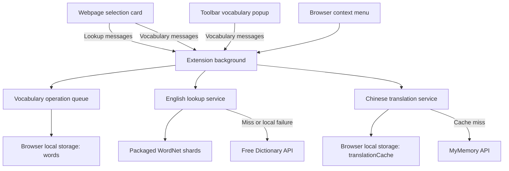

# Remember Me project architecture

Reviewed against the current working-tree source on 2026-10-08. This is an inventory of the implemented architecture, not a browser verification record. The [Cloudflare implementation plan](cloudflare-implementation-plan.md) describes proposed work separately.

## Current application boundary

Remember Me has a WXT browser extension using Vue 3/TypeScript and native macOS/iOS clients using SwiftUI. The extension selects words from webpages, looks up definitions/translations and stores encounters locally. Native targets provide local vocabulary, lookup/editing, backup/restore, review and sharing-draft code; platform/device acceptance and the full release remain in progress. The local Worker/D1 package implements native authentication and conditional sync operations, but is not deployed. Native Settings has explicit ownership/account-selection/sync paths; real Swift/HTTP-to-local-Worker integration now passes with separate synthetic device processes. Hosted/signed-device acceptance and the full website remain unfinished.

```text
rememberme/
├── AGENTS.md                       # Repository working instructions
├── README.md                       # Setup and documentation entry point
├── docs/
│   ├── architecture.md             # Implemented project architecture
│   └── cloudflare-implementation-plan.md  # Proposed website/backend/sync
├── frontend/
│   ├── README.md                   # Frontend boundaries
│   ├── browser-extension/          # WXT runtime
│   │   ├── entrypoints/            # Background, page content and toolbar popup
│   │   ├── components/             # Shared Vue UI
│   │   ├── services/               # Messaging, storage, lookup and theme logic
│   │   ├── types/                  # Data and message contracts
│   │   ├── assets/                 # Shared UI styles and page-host positioning
│   │   ├── public/                 # Packaged icons and WordNet dictionary data
│   │   ├── config/                 # Local feedback constants
│   │   ├── scripts/                # Dictionary generation and development tools
│   │   ├── preview/                # Component preview with sample data
│   │   ├── tests/                  # Content-entrypoint tests
│   │   ├── docs/                   # Extension behavior, architecture and checks
│   │   ├── package.json / package-lock.json / .nvmrc
│   │   └── wxt.config.ts / wxt.feedback.config.ts / vitest.config.ts
│   ├── apple/                      # Native targets, Swift packages, tests and docs
│   └── designs/                    # Static design references, not applications
├── contracts/                      # Shared schema and synthetic fixtures
└── backend/
    ├── src/                       # Auth, conditional D1 store, bounded HTTP/API
    ├── migrations/                # Versioned SQL schema
    ├── tests/                     # workerd/D1 and mocked provider fixtures
    ├── public/                    # Small connection page
    └── README.md                  # Independent package/lockfile and evidence
```

Extension tests also live alongside services/components and the popup entrypoint. Dependencies and generated files are omitted from the tree. The repository root has no Node package or workspace manifest; use the extension's `.nvmrc`, lockfile and `npm ci` from its package directory. Apple clients use Xcode/SwiftPM independently. Root `node_modules/` and the empty root `utils/` have been removed.

## Runtime and data flow



The background is part of the installed extension. It owns the vocabulary queue and provider requests; it is not a remote server. The content script extracts the selected sentence and URL and mounts its Vue card inside a closed ShadowRoot. The toolbar popup uses the same UI components/styles for the vocabulary list and reading view. Both use runtime messages for vocabulary operations. The browser context-menu handler runs in the background and uses the same storage service.

English and Chinese lookup are independent. A packaged English hit remains local, but an uncached Chinese request may still send the selected word to MyMemory. An English miss or local-data failure sends the word to Free Dictionary API. Neither provider request includes the saved sentence, webpage URL or full vocabulary list. This extension is not fully offline.

## State ownership and compatibility

| State | Owner and lifetime | Backup behavior |
| --- | --- | --- |
| `local:words` | Background storage service; persistent `WordEntry[]` in browser extension local storage | Exported as a plain JSON array |
| `local:translationCache` | Background translation service; persistent success cache, seven-day TTL, at most 500 entries | Excluded from vocabulary exports |
| `local:appearance` | Theme service; read/watched by page and popup, written by the popup | Excluded from vocabulary exports |
| English lookup results and parsed WordNet shards | Background memory; lost when that runtime restarts | Excluded from vocabulary exports |
| Selection, lookup state, list navigation and preview fixtures | UI memory; preview fixtures do not access vocabulary storage | Not exported |

Every vocabulary mutation uses one background promise queue and replaces the stored array after the operation succeeds. Reads wait for earlier queued operations. This queue coordinates live requests; it is not a persistent job queue or database transaction. Failed or disconnected write replies must not be retried automatically because persistence may already have completed.

Counts and histories are independent: reset sets the count to zero and keeps encounters. Imports validate the complete array before writing, normalize words, add matching counts and concatenate histories; importing the same file twice adds it twice. There is no version envelope or sync protocol. Preserve existing JSON compatibility when changing these contracts.

Imports, webpage context and provider text are untrusted. Render them as text, and allow navigation only for HTTP(S) history URLs. Exported contexts and full URLs may contain sensitive browsing data. See the [extension architecture](../frontend/browser-extension/docs/architecture.md) for message contracts, definition snapshots, queue limits and permissions.

## Development, build and reference boundaries

| Area | Role |
| --- | --- |
| Extension `.wxt/`, `.output/`, `node_modules/` | Generated types, build/package output and installed dependencies; regenerate using package commands |
| Root `.wxt/` and `.output/`, if present | Legacy artifacts outside the current package boundary; do not use them to load or build the extension |
| Extension `.local-feedback/` | Ignored local development logs |
| Local feedback watcher / macOS LaunchAgent | Optional loopback development service at `127.0.0.1:3937`; updates the separate feedback extension identity |
| Extension `preview/` and `test-selection.html` | Development preview and manual test page; not product entrypoints |
| `frontend/designs/` | Static HTML/style/image/design references; preview may use reference images, but these directories have no application runtime |
| Extension `public/dictionary/wordnet/` | Checked-in packaged data with licenses and metadata; rebuilt explicitly by `scripts/build-wordnet.py`, not fetched by ordinary installation |

Chrome/Edge production output is in `frontend/browser-extension/.output/chrome-mv3/`; Firefox output is `.output/firefox-mv2/` in the same package. Local feedback uses `.output/chrome-mv3-feedback/` and its development server. Build support and a healthy watcher do not prove that a browser loaded an update. See the [package README](../frontend/browser-extension/README.md), [local feedback guide](../frontend/browser-extension/docs/local-feedback.md) and [verification guide](../frontend/browser-extension/docs/testing.md).

## Planned architecture

The Cloudflare plan proposes a Vue/Vite website, a Hono Worker, D1, authentication, vocabulary migration, synchronization and review reminders. The full `frontend/website/` remains unimplemented; [backend setup/evidence](../backend/README.md) now describes the local Worker/D1 API. Root npm workspaces/website/extension migration are explicitly deferred while serving the Apple API dependency. The [Apple implementation plan](apple-clients-implementation-plan.md) is in progress: native local UI/lookup/backup/review and sharing-draft code exist; signed sharing, system notifications, full device/platform acceptance and cloud integration remain outstanding. See [native architecture](../frontend/apple/docs/architecture.md) for actual store boundaries and [native verification](../frontend/apple/docs/testing.md) for evidence. The runtime/data-flow sections above describe the extension and remain authoritative for it; native and extension stores are independent.

## Documentation map

| Question | Document |
| --- | --- |
| How do I install, develop, load or package the extension? | [Extension README](../frontend/browser-extension/README.md) |
| Which component owns a message, write or external request? | [Extension architecture](../frontend/browser-extension/docs/architecture.md) |
| What does the UI currently do, and which requirements remain unresolved? | [Behavior](../frontend/browser-extension/docs/behavior.md) |
| Where do definitions/translations come from? | [Dictionary sources and limits](../frontend/browser-extension/docs/dictionary.md) |
| What checks are needed and what has actually been run? | [Testing](../frontend/browser-extension/docs/testing.md) and its linked verification records |
| What is proposed for the website and backend? | [Cloudflare implementation plan](cloudflare-implementation-plan.md) |
| How will macOS and iOS clients be built and integrated? | [Apple clients implementation plan](apple-clients-implementation-plan.md) |

Archived specifications are historical context. Design references and dated verification records do not establish that today's working tree passes browser checks.
