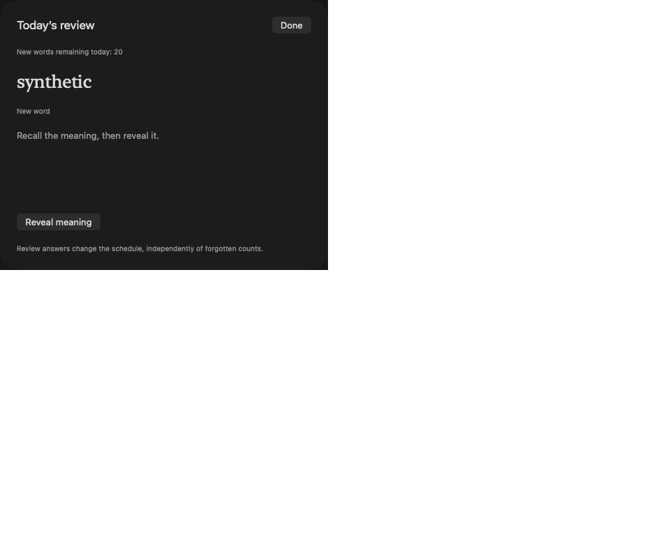
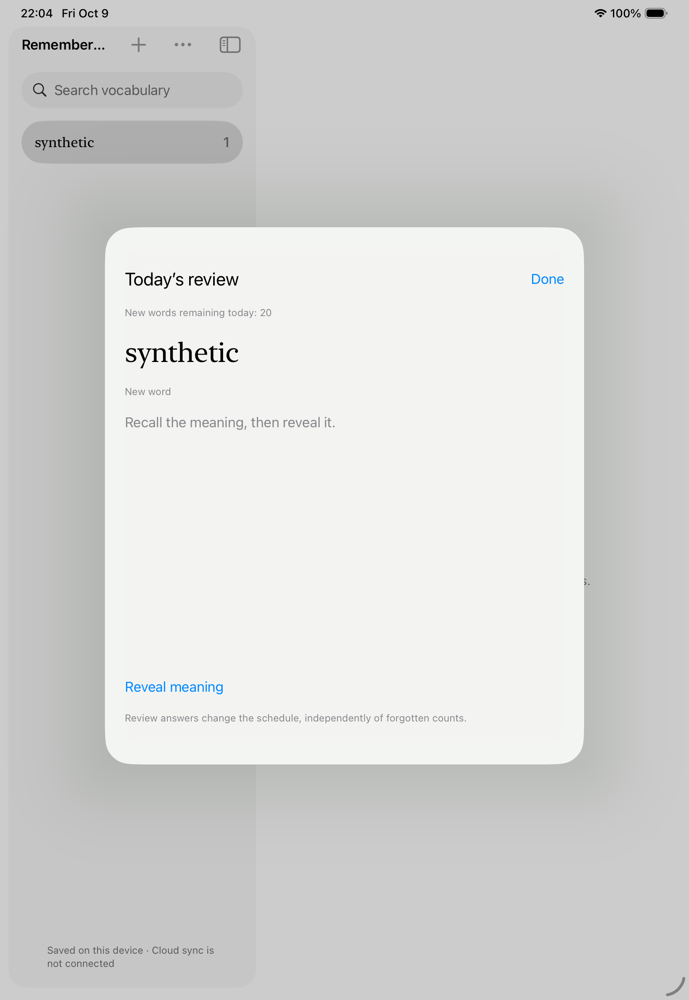
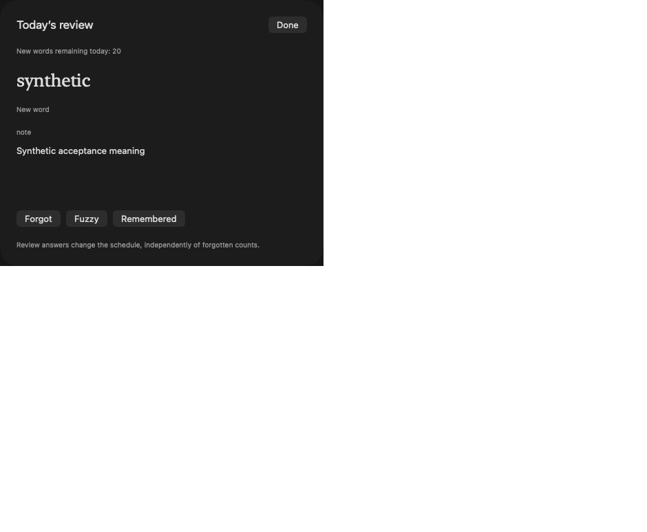
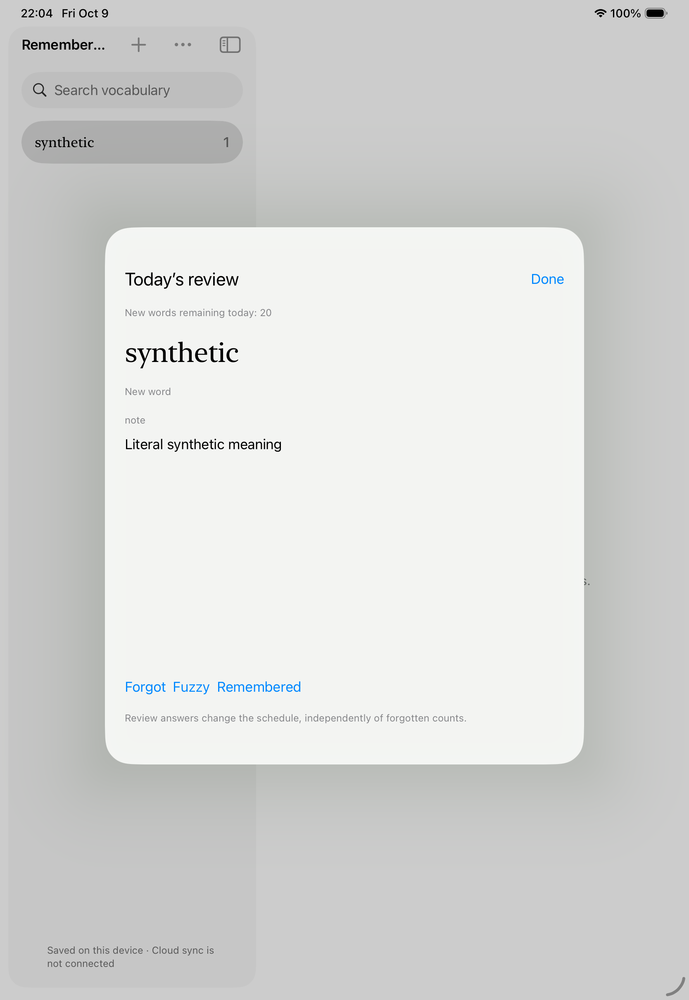
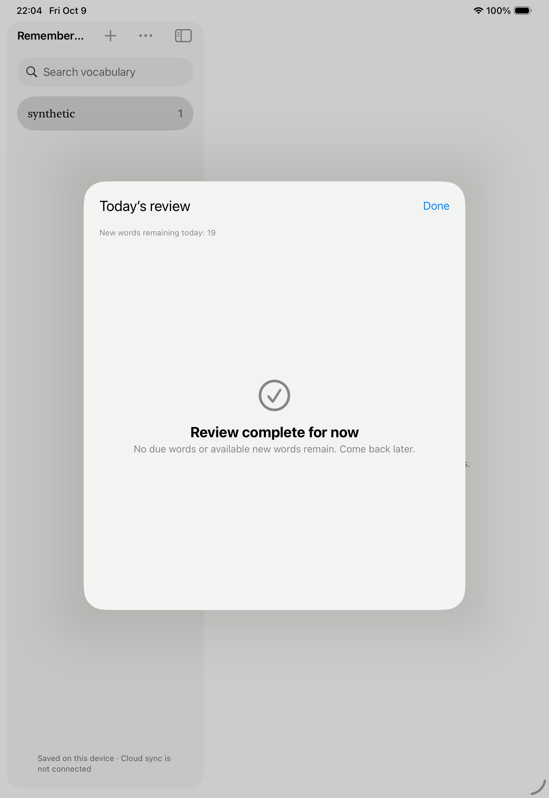

# Source privacy and local acceptance — 2026-10-09

## Result and boundaries

Native Settings now has independent context/URL consent, confirmed historical-source backfill and confirmed account-wide uploaded-source removal. Consent is local to each device as well as required by the account. Clearing pauses sync, persists an idempotent request, disables both account flags and blanks cloud encounter source fields. A lost reply survives process exit; retry completes the original receipt without erasing newly consented later uploads. Server validation and the D1 transaction guard reject older source revisions even after re-enabling. Old native source requests are retained as conflicts, preserving local data and frozen bytes; they are not silently rebased. New explicit backfill can upload retained local sources again without incrementing counts or replaying review.

Local implementation/checks pass. Hosted OAuth, registered capabilities/signing, physical-device sharing/two-device sync, actual notifications, complete VoiceOver/Dynamic Type acceptance and hosted large-store throughput are pending. Browser-extension source was not changed by this task; its pre-existing uncommitted changes were preserved.

## Verification

| Check | Observed result |
| --- | --- |
| Core Swift tests | 119 passed; disposable stores, including persistent removal/re-enable/frozen and unfrozen intent fencing, independent consent, count-preserving backfill and selection beyond 50 backed-off entries |
| UI presentation tests | 20 passed; synthetic service/vault, consent changes pause sync, committed removal reply loss retains retry state and blocks re-enabling |
| Backend tests | 32 passed; real local workerd/D1, independent fields/account isolation, unchanged count/history, committed receipt replay, explicit new backfill, stale operation/concurrent transaction rejection and request validation |
| TypeScript/shared fixtures | Backend typecheck and `contracts/reference.ts` passed |
| Worker build | `npm run build` dry run passed; no remote deployment |
| Real native HTTP harness | Swift/URLSession → local Worker/D1 passed: source consent/backfill, committed removal reply loss + `_exit` + new-process retry, re-enable/frozen-request rejection and later new backfill; existing refresh/ownership/conflict/backup/epoch coverage passed |
| Process recovery script | Import before/after publication, copy/stage/ready restart, shared inbox acknowledgment and frozen wire/identity/backoff checks passed |
| Mac build and manual interaction | Unsigned arm64 app built; isolated UUID store, create/manual definition, record, reset retaining one history record, relaunch persistence, review/Settings shortcuts, Space reveal and 3 = Remembered observed with native app/AX capture |
| iPad UI | 4 passed on iPad Pro 11-inch (M5), iOS Simulator 26.5; isolated temporary stores; final result at 22:02:14 test run. Compilation was rerun for the final account-identity guard |
| Staging preflight | Correctly failed current placeholders: missing real HTTPS origin, OAuth Client ID and D1 ID; secret/signing/group availability not checked |

Initial restricted test attempts could not listen on loopback/access CoreSimulator; approved local-only reruns succeeded. An old `/tmp` vs `/private/tmp` Swift module-cache collision was avoided with fresh, consistent absolute scratch paths. The initial backend lockfile missed Vitest's optional MSW 2 peer tree; it was completed without changing direct dependencies, then `npm ci` succeeded. The first Mac launch used an invalid disposable-store argument; using the expected UUID form succeeded. These failed attempts are not counted as acceptance passes.

Relevant commands:

```sh
# Packages use separate scratch directories; all fixtures are disposable.
swift test --disable-sandbox --scratch-path /private/tmp/rememberme-source-core --cache-path /private/tmp/rememberme-source-cache
swift test --disable-sandbox --scratch-path /private/tmp/rememberme-source-ui --cache-path /private/tmp/rememberme-source-ui-cache
node --experimental-strip-types contracts/reference.ts
# backend/, Node 22.22.3
npm ci
npm run typecheck
npm test
npm run build
npm run test:native -- /private/tmp/rememberme-source-core/arm64-apple-macosx/debug/RememberMeProbe
python3 frontend/apple/scripts/verify-process-recovery.py /private/tmp/rememberme-source-core/arm64-apple-macosx/debug/RememberMeProbe
```

## Large synthetic storage/outbox measurements

Mac arm64 debug probe; 10,000 synthetic words and 100,000 encounter records; no production vocabulary, accounts or dictionary calls. RSS includes fixture construction and Core Data. Values are observations from this run, not universal device guarantees.

| Measurement | Result |
| --- | --- |
| Initial generation/legacy import | 63.546 s |
| Append over existing large store | 9.838 s; 242 bounded copy chunks |
| Search p95, 30 first-page queries | 10.398 ms |
| Peak RSS, import/append run | 375,930,880 bytes / 358.5 MiB |
| Synthetic account outbox setup | 47.547 s |
| Status p95, 30 reads | 3.863 ms (previous 163.132 ms) |
| Frozen retry p95, 30 reads | 32.706 ms (previous 7183.489 ms) |
| First wire freeze | 605.052 ms (previous 3305.138 ms) |
| Reopen and recover exact frozen bytes | 78.957 ms (previous 2868.627 ms) |
| Peak RSS, optimized account outbox run | 474,775,552 bytes / 452.8 MiB |

The full-outbox decoding bottleneck was replaced by pending-operation pages of 50, ID dependency reads, filtered wire reads and database status counts. Search/import/RSS met the existing local debug budgets of 300 ms/90 s/512 MiB. This does not measure complete hosted upload/download, a fully acknowledged large wire ledger, full backup-restore candidate memory, target iPad RSS or release-mode responsiveness. Those remain explicit device/performance acceptance items.

Reproduce in fresh temporary stores:

```sh
RememberMeProbe benchmark /tmp/rememberme-large-store-NEW/store.sqlite
RememberMeProbe sync-benchmark /tmp/rememberme-sync-benchmark-NEW/store.sqlite
```

The new sync benchmark rejects an existing path and requires its synthetic directory prefix. It measures storage/outbox work without network I/O. `benchmark` must also be given a fresh disposable path.

## UI capture review

The first iPad run failed because the hidden/covered detail definition still existed in the accessible interface tree during review. Root detail now renders a review placeholder while the modal is open, so the definition is unavailable until explicit reveal. Final four UI tests passed. Mac sidebar minimum width now exposes add/options/search controls; review opens with ⇧⌘R and Settings with ⌘,. Review uses Space to reveal and 1/2/3 for answers.

1. **Before reveal — passed.** Mac and iPad show the word and recall prompt without the meaning; Mac AX tree also has no underlying meaning.




2. **Reveal — passed.** The manual literal definition becomes visible only after Space/click/tap, with three answer controls.




3. **Answer/complete — passed.** Remembered changes the review queue and daily remaining allowance, while forgotten count/history remain independent.




All screenshots were saved and visually inspected from the current run. Mac captures include the native sheet plus the capture surface's blank margin; no replacement/mock screenshot was used. The final iPad sidebar title truncates at this width but actions/search remain visible. This review did not measure contrast ratios, pointer target sizes, complete keyboard focus traversal, VoiceOver speech, accessibility text sizes, landscape/Split View or signed sharing. Source-account controls were tested through presentation models and real HTTP, not by a real signed-in platform UI session. No full accessibility compliance claim is made.

## Remaining staging/device gate

[Staging/device acceptance](../staging-device-acceptance.md) contains the read-only preflight, signing settings example and concrete login/share/two-device/privacy/notification/accessibility checklist. Actual environment identifiers and hardware are still needed; no resources were guessed or deployed. Migration 0005 must precede the source-privacy Worker update.
